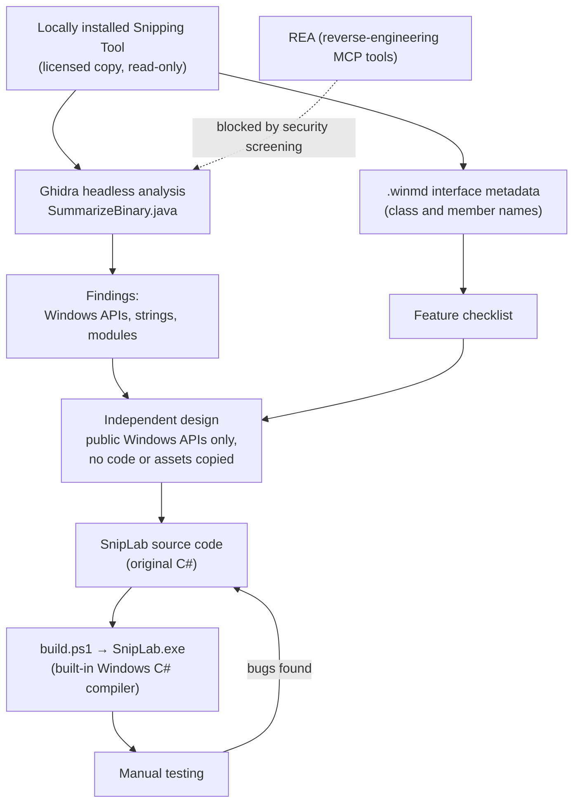
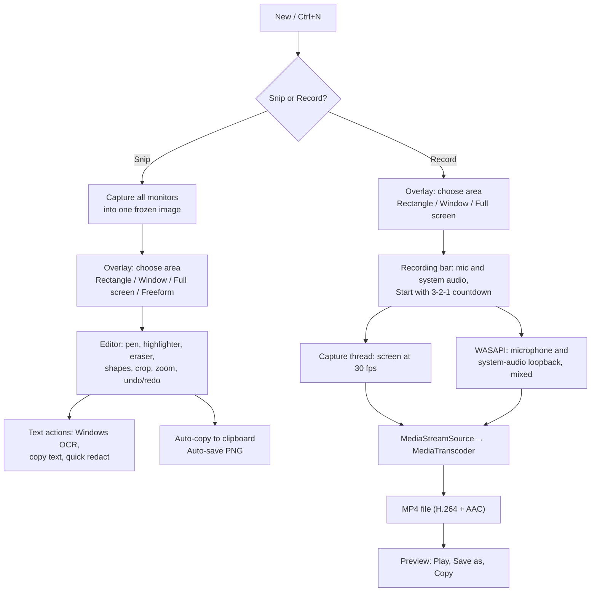

# SnipLab — A Reverse-Engineering Learning Project

> [!IMPORTANT]
> **For learning purposes only.** This project exists to practise reverse-engineering
> techniques (Ghidra) and Windows desktop development. It is **not** intended to clone,
> copy, replace or redistribute Windows Snipping Tool or any other official or copyrighted
> application. See [Disclaimer](#disclaimer).

SnipLab is a small screenshot and screen-recording app for Windows, written from scratch
in C#. It was built as an exercise: study how a real-world app is put together by
inspecting a locally installed copy of Windows Snipping Tool with Ghidra, then implement
similar *features* independently using public, documented Windows APIs.

---

## Table of contents

1. [Disclaimer](#disclaimer)
2. [Goals](#goals)
3. [Features](#features)
4. [How the project was done](#how-the-project-was-done)
5. [How SnipLab works](#how-sniplab-works)
6. [Project structure](#project-structure)
7. [Getting started](#getting-started)
8. [Using Ghidra](#using-ghidra)
9. [What the analysis showed](#what-the-analysis-showed)
10. [Lessons learned](#lessons-learned)
11. [Limitations and roadmap](#limitations-and-roadmap)
12. [REA status](#rea-status)

---

## Disclaimer

- **Educational use only.** This repository is a personal learning exercise in reverse
  engineering and Windows programming. It is not a product and is not meant for
  distribution or commercial use.
- **Not a clone.** It does not aim to reproduce any official or copyrighted application,
  and must not be used to create copies of them.
- **No proprietary code or assets.** No Microsoft source code, decompiled code, icons,
  images or other resources were copied. The analysis only identified *which* features
  and public Windows APIs the original uses. All SnipLab code is original. Icons come from
  the Segoe Fluent Icons font that ships with Windows.
- **Not affiliated.** "Windows" and "Snipping Tool" are trademarks of Microsoft
  Corporation. This project is not affiliated with, endorsed by or connected to Microsoft.
- **Your responsibility.** If you repeat these steps, analyse only software you are
  licensed to use, respect its licence terms and local law, and follow your organisation's
  security policies.

## Goals

- Learn to set up and use **Ghidra**: verify downloads, configure the JDK, run headless
  analysis and write a Ghidra script.
- Learn to read a binary's **imports, exports, strings and metadata** to understand its
  architecture without reading its source.
- Turn those findings into an **independent implementation** on public Windows APIs.
- Practise debugging real problems such as DPI scaling, video encoding and audio timing.

## Features

| Area | What SnipLab does |
|---|---|
| **Capture** | Rectangle, window, full-screen and freeform snips across all monitors; 0/3/5/10 s delay; optional mouse pointer and border |
| **Editing** | Ballpoint pen and highlighter (colours and sizes), stroke eraser and "Erase all ink", shapes (arrow, line, rectangle, oval), crop with handles, undo/redo, zoom |
| **Text actions** | OCR with the built-in Windows engine; select and copy text; **Copy all text**; **Quick redact** for emails and phone numbers |
| **Recording** | MP4 (H.264 + AAC, 30 fps) of a rectangle, window or full screen; microphone and system audio; 3-2-1 countdown; pause/resume; stop; delete |
| **Output** | Auto-copy to clipboard; auto-save to `Pictures\Screenshots` and `Videos\Screen Recordings`; Save as PNG/JPEG/MP4; open image files |
| **Look** | Windows 11 style; follows the system light/dark theme and accent colour; settings saved to `%AppData%\SnipLab\settings.ini` |

## How the project was done



## How SnipLab works



> The diagrams use [Mermaid](https://mermaid.js.org/). GitHub renders them automatically.
> In VS Code, install a Mermaid preview extension to see them in the Markdown preview.

## Project structure

```
REA 2/
├── README.md
├── ghidra.ps1                  # launches Ghidra (GUI or headless) with the right JDK
├── ghidra-scripts/
│   └── SummarizeBinary.java    # Ghidra script: imports, exports, feature strings
├── ghidra-projects/            # Ghidra project with the analysed binaries
└── SnipLab/
    ├── build.ps1               # builds with csc.exe from .NET Framework (no SDK needed)
    ├── bin/SnipLab.exe         # build output
    └── src/
        ├── Program.cs          # entry point, per-monitor DPI awareness
        ├── MainForm.cs         # main window, toolbar, snip/record flow
        ├── OverlayForm.cs      # frozen-screen overlay and capture-mode bar
        ├── InkCanvas.cs        # editor surface: ink, shapes, crop, OCR selection, undo
        ├── Annotations.cs      # strokes, shapes, redactions
        ├── InkOptionsPanel.cs  # colour/size/shape flyout
        ├── TextRecognizer.cs   # Windows.Media.Ocr wrapper
        ├── ScreenCapture.cs    # screen copy, window list, mouse pointer
        ├── ScreenRecorder.cs   # frame capture + MP4 encoding
        ├── AudioCapture.cs     # WASAPI microphone / loopback capture
        ├── RecordingSession.cs # recording bar, outline, result view
        ├── Theme.cs, Controls.cs, Settings.cs, WinRtAsync.cs, NativeMethods.cs
```

## Getting started

### Prerequisites

- Windows 10 (version 1903 or later) or Windows 11
- .NET Framework 4.8 (included with Windows). No Visual Studio or .NET SDK required.
- For the analysis part only: Ghidra 12.1.4 and a JDK 21

| Tool | Location used | Notes |
|---|---|---|
| Ghidra 12.1.4 | `C:\Tools\ghidra_12.1.4_PUBLIC` | Zip SHA-256 matched the official release |
| Temurin JDK 21.0.12.1 | `C:\Tools\jdk-21.0.12.1+1` | Zip SHA-256 matched Adoptium's |

### Build and run

```powershell
& 'C:\Daily learnings\REA 2\SnipLab\build.ps1'
& 'C:\Daily learnings\REA 2\SnipLab\bin\SnipLab.exe'
```

Close SnipLab before rebuilding; a running copy locks the `.exe`.

### Quick use

| Action | How |
|---|---|
| New snip or recording | **New** or `Ctrl+N` (camera icon = snip, video icon = record) |
| Cancel a capture | `Esc` or right-click |
| Tool options | Click the selected pen, highlighter, eraser or shapes button again |
| Crop | Crop button, drag handles, `Enter` to apply, `Esc` to cancel |
| Copy / Save | `Ctrl+C` / `Ctrl+S` |
| Undo / Redo | `Ctrl+Z` / `Ctrl+Y` |
| Zoom | `Ctrl` + mouse wheel, `Ctrl` + `+`/`-`, click the % to fit |
| Settings | **⋯** menu |

## Using Ghidra

```powershell
# Open the Ghidra GUI, then File > Open Project > ghidra-projects\SnippingTool.gpr
.\ghidra.ps1

# Headless: analyse a binary and print a summary
.\ghidra.ps1 -Binary '<path to a .dll or .exe you are licensed to analyse>'
```

- `SummarizeBinary.java` accepts keywords as script arguments
  (`-postScript SummarizeBinary.java Pen Crop Ocr`) to change which strings it reports.
- `ghidra.ps1` sets `JAVA_HOME` for that run only. Ghidra's launcher looks for `java` on
  `PATH` before it reads `JAVA_HOME_OVERRIDE` in `support\launch.properties`.

Things to try in the GUI:

- **Symbol Tree → Imports**: every Windows API the binary calls.
- **Window → Defined Strings**: search for configuration names and messages.
- **Right-click an import → References → Show References to**: jumps to the code that calls
  it. The **Decompiler** window shows that function as C-like code (for understanding
  only; do not copy it).
- **Window → Function Graph**: control flow of the selected function as a diagram.

## What the analysis showed

Only imports, strings and metadata were used. No decompiled code was read or reused.

### Package layout

The app is split into modules: a main executable, a XAML UI library, a capture
component, an OCR component, an AI component, OpenCV and ONNX Runtime libraries, and a
.NET runtime component. Each module has a `.winmd` file describing its classes and members.

### Capture component (357 functions)

- Written in **C++/WinRT**. Its only exports are `DllGetActivationFactory` and
  `DllCanUnloadNow`, as with every WinRT component.
- A thin layer around `Windows.Graphics.Capture.GraphicsCaptureItem` and
  `Windows.Graphics.Printing.PrintManager`.

### Main executable (5,020 functions, 51 imported DLLs)

| Evidence | What it tells us | What SnipLab does |
|---|---|---|
| `EnumWindows`, `GetWindowRect`, `IsWindowVisible` | Window mode walks top-level windows | `ScreenCapture.GetTopLevelWindows` |
| `DwmGetWindowAttribute` / `DwmSetWindowAttribute` | Real window bounds, cloaked windows, dark title bar | Same DWM attributes |
| `EnumDisplayMonitors`, `GetDpiForMonitor` | Multi-monitor and per-monitor DPI | Per-monitor DPI awareness |
| `D3D11CreateDevice`, `CreateDXGIFactory1`, HDR strings | GPU capture with HDR tone-mapping | Simplified: GDI `CopyFromScreen` |
| `MFStartup`, `ActivateAudioInterfaceAsync` | Media Foundation recording with audio | `MediaTranscoder` + WASAPI |
| `SetWindowDisplayAffinity` | Keeps its own windows out of captures | Recording bar and outline excluded the same way |
| `SHGetKnownFolderPath`, `PathYetAnotherMakeUniqueName` | Auto-save with unique file names | Unique names in `Pictures` / `Videos` |

### UI metadata (feature checklist)

The UI's `.winmd` lists names such as pen, highlighter, stroke eraser, shapes, crop,
undo/redo, text actions, redaction, zoom, recording controls (start, pause/resume, stop,
cancel), microphone and system-audio toggles, and auto-save settings. These became
SnipLab's feature checklist. Emoji, text boxes, ruler, colour picker and GIF export were
left out.

## Lessons learned

- **DPI awareness matters.** A DPI-unaware capture returned 3072×864 on this laptop; a
  DPI-aware one returned the real 3840×1200, matching DWM window bounds.
- **WinRT from .NET Framework is possible without an SDK.** It needs the right reference
  assemblies. Without the combined `Windows.winmd`, async WinRT calls are awaited through
  their `Completed` callbacks (`WinRtAsync.cs`).
- **Uncompressed video frames are bottom-up.** Media Foundation reads RGB frames bottom row
  first, so rows are copied in reverse; the first test video came out upside down.
- **Memory churn causes audio glitches.** Allocating a new multi-megabyte frame buffer 30
  times a second triggered garbage collection about once a second and broke up
  microphone audio. Reusing buffers and waiting for late audio fixed it.
- **Security tools watch behaviour.** CrowdStrike Falcon blocked an AI-generated test
  script that loaded the app into PowerShell and captured the screen. Test screen- and
  audio-capture features manually, and involve your security team early.
- **Verify what you download.** Ghidra and the JDK were checked against official SHA-256
  checksums before use.

## Limitations and roadmap

- Screen capture uses GDI, so HDR content may look washed out and recording very large
  areas may be less smooth. Next step: `Windows.Graphics.Capture` on the GPU.
- No built-in video player, trimming or GIF export.
- No emoji, text boxes, ruler or colour picker.
- Not explored yet: Ghidra's GUI decompiler, and the .NET module (which needs a .NET
  decompiler rather than Ghidra).

## REA status

REA (reverse-engineer-anything) is an MCP server that would add interactive decompiling,
.NET analysis, runtime observation and rebuild-coverage checks. It is configured as
`npx -y rea-agents@6.8.0 mcp`, which downloads and runs the package on every start, so the
organisation's skill screening blocked it as unreviewed downloaded code. To use it:

1. Ask IT/Security to review `rea-agents@6.8.0`.
2. If approved, install it locally (`npm install -g rea-agents@6.8.0`).
3. Point the `rea` server in `.claude.json` at the local `rea mcp`.
4. Re-run the screening. Runtime-observation features (process capture, Frida) also need
   Security's approval, since they behave like monitoring tools.

---

*SnipLab is a learning project. It is provided as-is, without warranty, and is not intended
for production use or distribution.*
